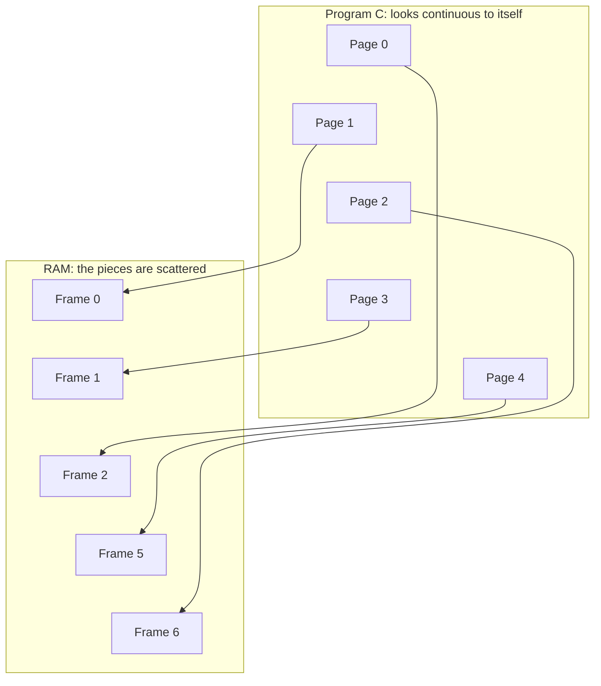

# 1. Why Paging Exists

[Back to index](README.md) | [Next: How paging works](02_how_paging_works.md)

## The problem: keeping a program in one piece

Suppose the OS had to give every program one unbroken stretch of RAM. Think of a restaurant where a group must sit together at adjacent seats.

There are 10 seats. Groups A and B are seated, and then some groups leave:

Six seats are free, but a group of 5 **cannot sit**, because the largest run of adjacent free seats is only 3.

This waste is called **external fragmentation**: there is enough free memory in total, but it is broken into pieces too small to use.

The OS could shuffle everyone along to close the gaps. That is called **compaction**, and it is slow, because it means copying large amounts of memory around.

## The fix: let the group split up

If the group of 5 doesn't have to sit together, they just take any 5 free seats, and a seating chart tells the waiter where everyone is.

That is paging. A program no longer needs one continuous stretch of RAM.

## The benefits

1. **No external fragmentation.** Every frame is the same size, so any free frame fits any page.
2. **Programs can be bigger than RAM.** Rarely used pages can wait on disk (see [part 4](04_page_faults_and_replacement.md)).
3. **Programs are protected from each other.** Each program has its own page table, so it can't even name another program's memory. It is like having a notebook that only lists your own lockers.
4. **Programs can share memory safely.** If 10 programs use the same library, their page tables can all point to the same frames, so RAM holds one copy instead of 10.
5. **Programming is simpler.** Each program sees a clean, private address space and doesn't care where it actually sits in RAM.

## The trade-off: internal fragmentation

Paging swaps one kind of waste for a smaller one. Memory is handed out in whole pages, so the last page of a program is usually only partly full.

**Example:** with 4 KB pages, a 10 KB program needs 3 pages, which is 12 KB. The last page wastes 2 KB.

It is like a box that is only half full: it still takes up a whole locker. This is **internal fragmentation**, meaning the waste is *inside* the space you were given.

| Type | Where the waste is | Example | Does paging have it? |
|---|---|---|---|
| External | Gaps *between* allocations | 6 free seats, but no 5 in a row | No |
| Internal | Unused space *inside* an allocation | A half-empty box in a locker | Yes, but it is small |

## Key takeaway

Paging stops requiring programs to sit in one continuous block of RAM. In exchange, it needs a lookup table, and the next part shows how that works.
