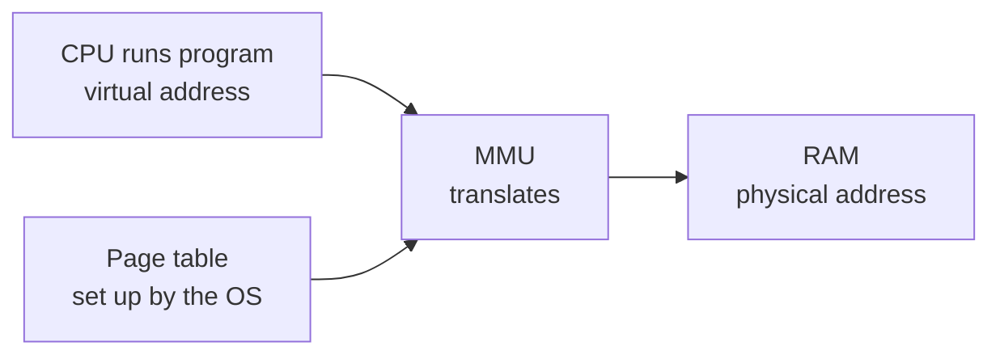
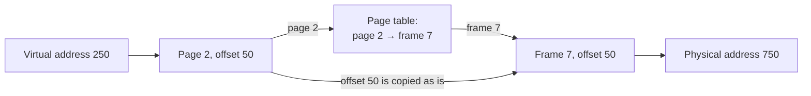
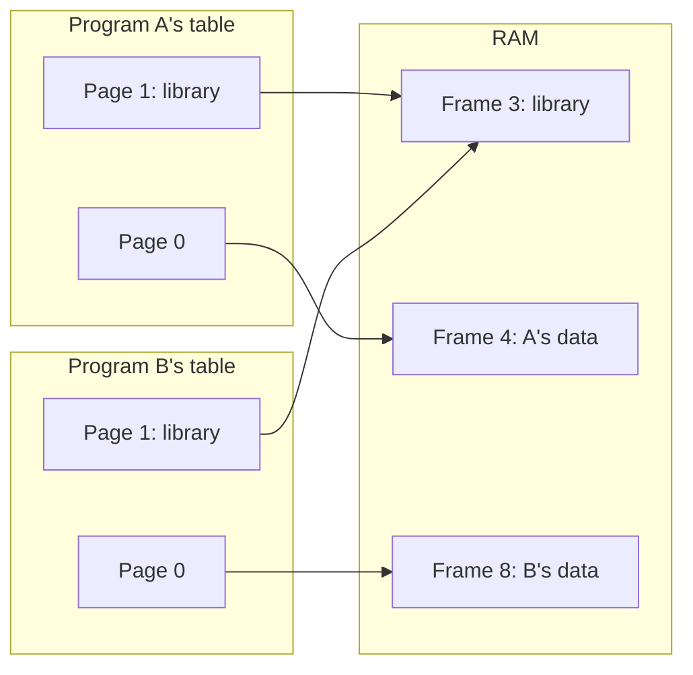

# 2. How Paging Works

[Back to index](README.md) | [Previous: Why paging exists](01_why_paging_exists.md) | [Next: The TLB](03_tlb_speeding_it_up.md)

## Four terms

| Term | Meaning | Analogy |
|---|---|---|
| **Page** | A fixed-size piece of a program's memory | Box |
| **Frame** | A slot of the same size in RAM | Locker |
| **Page table** | A per-program list mapping pages to frames | Notebook |
| **Offset** | The position inside a page | "Item 50 in the box" |

Pages and frames are always the same size. That is why any page fits in any frame. A common page size is **4 KB**.

## Two kinds of address

- A **virtual address** is the address a program uses. Each program has its own set.
- A **physical address** is the real location in RAM.

Programs only ever see virtual addresses. The address `1000` in program A and `1000` in program B are usually different places in RAM, just as "Flat 5" on two different streets is two different homes.

A piece of hardware called the **MMU** (Memory Management Unit) translates each address as it is used. The OS fills in the page tables, and the MMU reads them.



## Worked example with easy numbers

Real page sizes are powers of 2, but let's first use a **page size of 100 bytes** so the arithmetic is obvious.

The program's page table is:

| Page | Frame |
|---|---|
| 0 | 5 |
| 1 | 2 |
| 2 | 7 |
| 3 | 1 |

**Question:** the program reads virtual address **250**. Where is that in RAM?

1. **Split the address.** 250 means page **2**, offset **50** (`250 / 100 = 2` remainder `50`).
2. **Look up the page.** The table says page 2 is in frame **7**.
3. **Keep the offset.** Offset 50 stays the same, because an item's position inside the box doesn't change when the box moves.
4. **Build the physical address.** `7 × 100 + 50 =` **750**.



The formula is always:

```text
page number      = virtual address / page size   (whole number part)
offset           = virtual address % page size   (remainder)
physical address = frame number × page size + offset
```

Only the page number changes during translation. The offset passes straight through.

## The same example with a real page size

With 4 KB pages, the page size is 4096 bytes. Take virtual address **8200**, and use the same table:

1. `8200 / 4096 = 2` remainder `8`, so that is page **2**, offset **8**.
2. Page 2 is in frame **7**.
3. `7 × 4096 + 8 =` **28680**.

### Why page sizes are powers of 2

Computers don't actually need to divide. With a power-of-2 page size, an address splits cleanly into two groups of bits. With 4 KB pages (2¹² bytes), the low 12 bits are the offset and the rest are the page number:

```text
Virtual address 8200  = 0x2008  ->  page 0x2 | offset 0x008
Page table says page 0x2 is in frame 0x7
Physical address      = 0x7008  ->  frame 0x7 | offset 0x008  = 28680
```

Each hex digit is 4 bits, so the last three digits are the 12-bit offset. The hardware simply swaps the front part and keeps the back part. It's like a phone number where the area code gets replaced and the local number stays the same.

## What else is in a page table entry?

Each row holds more than a frame number. It also has a few small flags:

| Flag | Question it answers | Why it matters |
|---|---|---|
| **Present** (valid) | Is this page in RAM right now? | If not, the OS must step in (see [part 4](04_page_faults_and_replacement.md)) |
| **Read/Write** | May this page be written to? | Protects code and read-only data |
| **User/Kernel** | May ordinary programs touch it? | Protects the OS from programs |
| **Dirty** | Has it changed since being loaded? | Changed pages must be saved before eviction |
| **Accessed** | Has it been used recently? | Helps the OS choose what to evict |

These flags are what cause a **segmentation fault**. If a program touches a page it has no mapping for, or writes to a read-only page, the MMU stops and hands control to the OS, which usually ends the program. In C, dereferencing a `NULL` pointer crashes for exactly this reason: page 0 is deliberately left unmapped.

## Every program gets its own table

Here, both programs use page 0, but they end up in different frames and can't touch each other's data. Frame 3 is the exception: both tables point to it on purpose, so they share one copy of a library.



When the CPU switches programs, the OS points the MMU at the new program's page table. On x86, that pointer lives in a register called `CR3`.

## Key takeaway

An address is a page number plus an offset. The page table replaces the page number with a frame number, and the offset stays the same.

But notice a problem: the page table itself is stored in RAM, so each memory access now seems to need an extra memory access. The next part fixes that.
