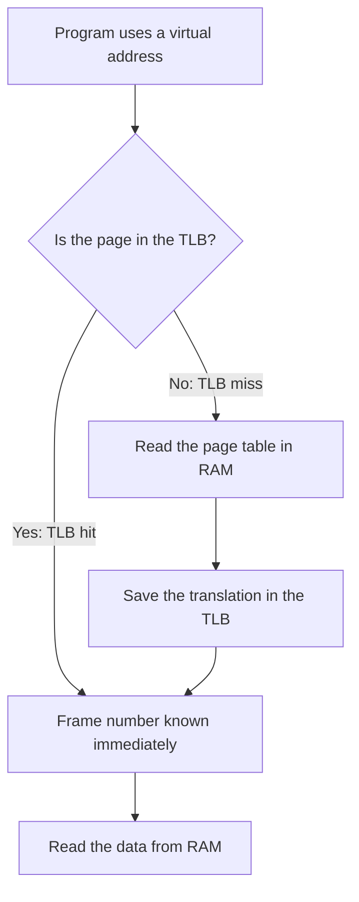

# 3. The TLB: Making Paging Fast

[Back to index](README.md) | [Previous: How paging works](02_how_paging_works.md) | [Next: Page faults and replacement](04_page_faults_and_replacement.md)

## The problem

The page table lives in RAM. So reading one value takes two trips:

1. Read the page table to find the frame.
2. Read the actual data.

Every memory access would take twice as long. It's like walking to the front desk to check the notebook every single time you need something from your locker.

## The fix: a sticky note

You'd soon jot down the lockers you use most on a sticky note in your pocket. The **TLB** (Translation Lookaside Buffer) is that sticky note. It is a small, very fast cache inside the CPU, holding recent page-to-frame translations.



## Why such a small cache works so well

A TLB may hold only a few thousand entries or fewer, yet it usually gets the vast majority of lookups right. This is because of **locality**: programs tend to reuse what they just used, and to use what's next to it.

**Example:** a loop adding up an array of 1,000 4-byte integers touches 4,000 bytes, which fits in about one 4 KB page. The first access may miss the TLB, and the rest then hit, because they are all on the same page.

```c
int total = 0;
for (int i = 0; i < 1000; i++) {
    total += numbers[i];   /* nearly every access is to the same page */
}
```

## How much does it help?

Assume a RAM access takes 100 ns, the TLB lookup takes almost no time, and there is a single-level page table.

| Case | Trips to RAM | Time |
|---|---|---|
| TLB hit | 1 (data) | 100 ns |
| TLB miss | 2 (page table + data) | 200 ns |
| No TLB at all | 2 (always) | 200 ns |

With a **99% hit rate**, the average is:

```text
average = 0.99 × 100 ns + 0.01 × 200 ns
        = 99 ns + 2 ns
        = 101 ns
```

So the average access takes 101 ns rather than 200 ns, which is only 1% slower than having no translation at all.

## What happens when the CPU switches programs?

Page 2 means something different in each program, so old TLB entries could send the new program to the wrong frame. There are two common fixes:

- **Flush the TLB:** wipe it on every switch. This is simple, but the new program starts with a cold cache.
- **Tag each entry:** label every entry with its owner, so entries from different programs can coexist. These labels are called ASIDs in general, and PCIDs on x86.

## Key takeaway

The TLB caches recent translations, and locality means it usually has the answer. That makes paging cheap in practice.
