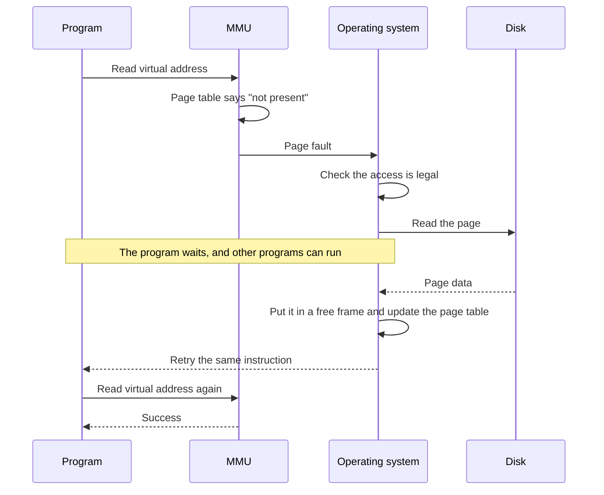
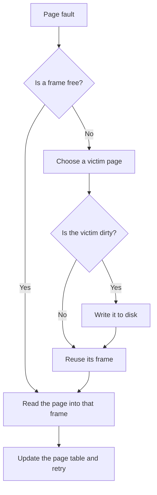
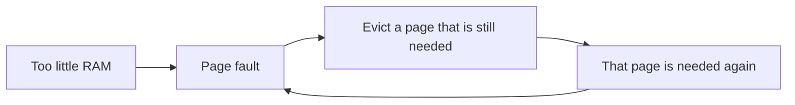

# 4. Page Faults and Page Replacement

[Back to index](README.md) | [Previous: The TLB](03_tlb_speeding_it_up.md) | [Next: Multi-level page tables](05_multilevel_page_tables.md)

## Demand paging: load only what's needed

When you open a large app, the OS doesn't load the whole thing into RAM. It loads pages only when they are first used. This is **demand paging**.

Think of the off-site warehouse: you keep your everyday things in your lockers and fetch the rest only when you need them. This is also how programs can use more memory than the machine has RAM.

## What is a page fault?

A **page fault** is what happens when a program touches a page that isn't currently in RAM. Despite the name, it is usually not an error. It is the normal signal that the OS needs to fetch something.



The program never notices, other than the delay.

If the access is *not* legal, for example the address was never allocated, the OS ends the program. That is the segmentation fault from [part 2](02_how_paging_works.md).

## Page faults are expensive

Using rough, typical figures:

| Operation | Rough time |
|---|---|
| RAM access | 100 nanoseconds |
| Reading from an SSD | 100 microseconds (about 1,000 times slower) |
| Reading from a hard disk | 10 milliseconds (about 100,000 times slower) |

If a RAM access were one second, an SSD read would be about 17 minutes and a hard disk read would be more than a day. So the OS tries hard to keep the right pages in RAM.

## When RAM is full: page replacement

If there is no free frame, the OS must evict a page to make room.

- If the page is **clean** (unchanged), its frame can simply be reused, since the disk already has a good copy.
- If the page is **dirty** (changed), it must be written to disk first.



## Which page should be evicted?

Let's compare three policies. RAM has **3 frames**, and the program uses pages in this order:

```text
1, 2, 3, 1, 4, 1, 2
```

### FIFO: evict the page that arrived first

Like a queue, the oldest arrival goes first, however useful it is.

| Page used | Frames afterwards | Result | Evicted |
|---|---|---|---|
| 1 | 1 | Fault | |
| 2 | 1, 2 | Fault | |
| 3 | 1, 2, 3 | Fault | |
| 1 | 1, 2, 3 | Hit | |
| 4 | 2, 3, 4 | Fault | 1 |
| 1 | 3, 4, 1 | Fault | 2 |
| 2 | 4, 1, 2 | Fault | 3 |

**Total: 6 faults.** FIFO threw out page 1 even though it had just been used, and needed it again right away.

### LRU: evict the least recently used page

If you haven't used something for a while, you probably won't need it soon. In this table, frames are listed from least to most recently used.

| Page used | Frames afterwards | Result | Evicted |
|---|---|---|---|
| 1 | 1 | Fault | |
| 2 | 1, 2 | Fault | |
| 3 | 1, 2, 3 | Fault | |
| 1 | 2, 3, 1 | Hit | |
| 4 | 3, 1, 4 | Fault | 2 |
| 1 | 3, 4, 1 | Hit | |
| 2 | 4, 1, 2 | Fault | 3 |

**Total: 5 faults.**

### Optimal: evict the page needed furthest in the future

This is the best possible policy, but it requires seeing the future, so it can't be built. It is used as a benchmark for judging real policies.

| Page used | Frames afterwards | Result | Evicted |
|---|---|---|---|
| 1 | 1 | Fault | |
| 2 | 1, 2 | Fault | |
| 3 | 1, 2, 3 | Fault | |
| 1 | 1, 2, 3 | Hit | |
| 4 | 1, 2, 4 | Fault | 3 (never used again) |
| 1 | 1, 2, 4 | Hit | |
| 2 | 1, 2, 4 | Hit | |

**Total: 4 faults.**

### Comparison

| Policy | Faults here | How it decides | Practical? |
|---|---|---|---|
| FIFO | 6 | Oldest arrival | Yes, but it can evict busy pages |
| LRU | 5 | Unused for the longest | Exact tracking is too costly, so it is approximated |
| Optimal | 4 | Needed furthest ahead | No, it is only a benchmark |

Real systems approximate LRU using the **accessed** flag. A well-known version is the **clock algorithm**: it sweeps around the pages like a clock hand, gives any page with the flag set a second chance by clearing the flag, and evicts the first page whose flag is already clear.

## Thrashing: when it all falls apart

If programs together actively need more memory than RAM has, each fault evicts a page that is needed again almost immediately. The machine spends its time moving pages rather than doing work.

It is like a desk too small for the three books you are reading: you spend all afternoon swapping books and read nothing. If your computer has ever slowed to a crawl with too many apps open, you have probably seen this.



The fixes are to run fewer programs at once, or to add more RAM.

## Key takeaway

A page fault means "this page isn't in RAM yet, so go and get it". It is normal, but slow. When RAM is full, the OS evicts the page it predicts is least useful, and that prediction is based on recent use.
