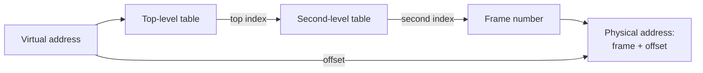
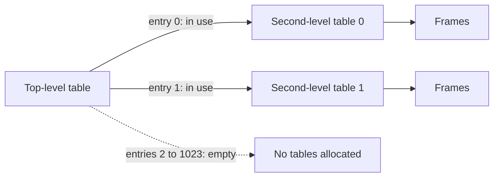

# 5. Multi-Level Page Tables

[Back to index](README.md) | [Previous: Page faults and replacement](04_page_faults_and_replacement.md) | [Next: Cheat sheet and practice](06_cheat_sheet_and_practice.md)

## The problem: page tables are huge

Take a 32-bit system with 4 KB pages:

```text
Address space     = 2^32 bytes = 4 GB
Number of pages   = 4 GB / 4 KB = 2^20, about 1 million
Size of one entry = 4 bytes
Page table size   = 1 million × 4 bytes = about 4 MB
```

That is **4 MB per program**, even for a tiny program, because a simple table needs a row for every page it *could* use. With 100 programs running, that is about 400 MB of tables, and most of the rows would be empty.

## The fix: an index of indexes

Think of a phone book for a whole country. Rather than printing a blank line for every possible number, you have a main directory listing cities, and you only print a city's book if someone lives there.

A **two-level page table** does the same. The address is split into three parts:

```text
32-bit address:  | 10 bits: top index | 10 bits: second index | 12 bits: offset |
```



The trick is that **a second-level table only exists if that region of memory is in use**. Unused regions just have an empty row at the top level.



## How much does it save?

Each table has 2¹⁰ = 1,024 entries of 4 bytes each, so each is 4 KB. One second-level table covers 1,024 × 4 KB = 4 MB of memory.

Take a program using 8 MB, all in one aligned region:

| Design | Tables needed | Memory used |
|---|---|---|
| Single-level | 1 full table | 4 MB |
| Two-level | 1 top-level + 2 second-level | 12 KB |

That is about 340 times smaller. (A real program's memory is more spread out, so it needs a few more tables, but the saving is still large.)

## 64-bit systems use more levels

A flat table is impossible on 64-bit systems. Typical x86-64 systems use 48-bit virtual addresses with **4 levels**, and newer hardware can use 5:

```text
48-bit address:  | 9 bits | 9 bits | 9 bits | 9 bits | 12-bit offset |
```

## The cost, and how it's handled

More levels mean more trips to RAM on a TLB miss. With 4 levels, a miss takes 4 reads to walk the tables, plus 1 for the data, which is 5 in total.

This is why the [TLB](03_tlb_speeding_it_up.md) matters so much. On a hit, none of those table reads are needed.

## Key takeaway

Multi-level tables only spend memory on the regions a program really uses. The extra lookups are mostly hidden by the TLB.
