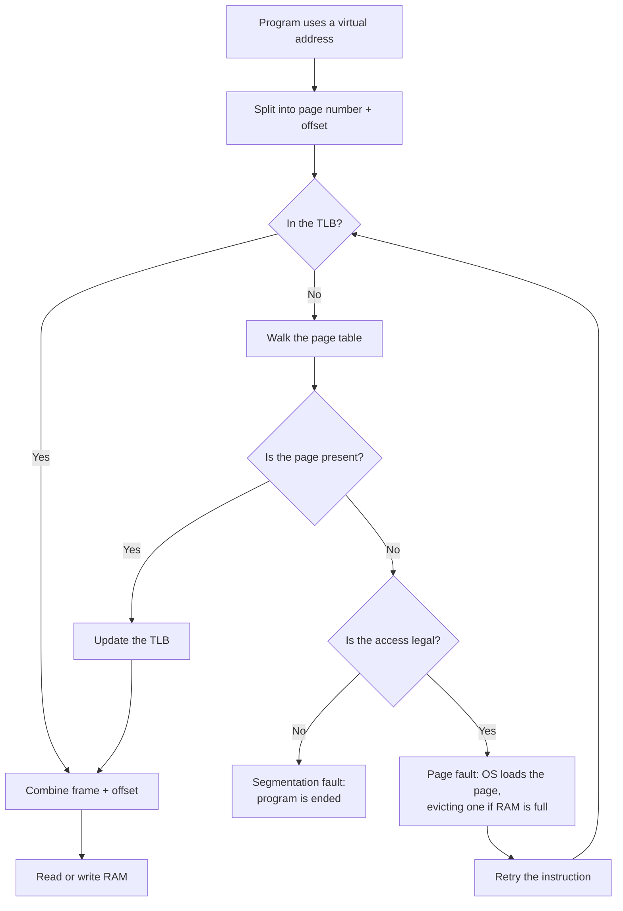

# 6. Cheat Sheet and Practice

[Back to index](README.md) | [Previous: Multi-level page tables](05_multilevel_page_tables.md)

## The whole journey of a memory access



## Glossary

| Term | Plain meaning |
|---|---|
| Page | Fixed-size piece of a program's memory |
| Frame | Same-sized slot in RAM |
| Page table | Per-program list of which page is in which frame |
| Virtual address | The address a program sees |
| Physical address | The real RAM location |
| Offset | Position inside a page; never changes in translation |
| MMU | Hardware that translates addresses |
| TLB | Fast cache of recent translations |
| TLB miss | Translation isn't cached, so the page table must be read |
| Page fault | The page isn't in RAM, so the OS must step in |
| Demand paging | Loading pages only when first used |
| Dirty page | A page changed since loading, which must be saved before eviction |
| Swap space | Disk area that holds evicted pages |
| Thrashing | So much page swapping that little real work gets done |
| External fragmentation | Free memory is split into gaps too small to use |
| Internal fragmentation | Unused space inside an allocated page |

## Formulas

```text
page number      = virtual address / page size   (whole number part)
offset           = virtual address % page size
physical address = frame number × page size + offset

offset bits      = log2(page size)
number of pages  = address space size / page size
table size       = number of pages × entry size

average access   = hit rate × hit time + (1 - hit rate) × miss time
```

## Try it on Linux

```bash
# Your system's page size in bytes
getconf PAGESIZE

# The memory regions of the running process (here, the grep command itself)
grep -E 'heap|stack|libc' /proc/self/maps

# Total and available RAM, and swap
free -h

# si and so columns show pages being swapped in and out; press Ctrl+C to stop
vmstat 1
```

## Practice questions

Try each one before opening the answer.

**Q1.** With a page size of 100 bytes, which page and offset does virtual address 475 refer to?

<details>
<summary>Answer</summary>

`475 / 100 = 4` remainder `75`, so it is page 4, offset 75.

</details>

**Q2.** Using the table below and a 100-byte page size, what is the physical address of virtual address 130?

| Page | Frame |
|---|---|
| 0 | 3 |
| 1 | 6 |
| 2 | 4 |

<details>
<summary>Answer</summary>

Address 130 is page 1, offset 30. Page 1 is in frame 6, so the physical address is `6 × 100 + 30 = 630`.

</details>

**Q3.** With 4 KB pages, how much is wasted by a 13 KB program?

<details>
<summary>Answer</summary>

It needs 4 pages, which is 16 KB, so `16 - 13 = 3 KB` is wasted. This is internal fragmentation.

</details>

**Q4.** A system has 32-bit addresses and 8 KB pages. How many bits are in the offset, and how many pages are there?

<details>
<summary>Answer</summary>

8 KB is 2¹³ bytes, so there are 13 offset bits. That leaves `32 - 13 = 19` bits for the page number, so there are 2¹⁹ = 524,288 pages.

</details>

**Q5.** A RAM access takes 100 ns, TLB lookups take almost no time, and there is a single-level page table. What is the average access time with a 90% TLB hit rate?

<details>
<summary>Answer</summary>

`0.9 × 100 + 0.1 × 200 = 90 + 20 = 110 ns`.

</details>

**Q6.** With 3 frames and the page sequence `1, 2, 3, 4, 1, 2`, how many faults does FIFO cause?

<details>
<summary>Answer</summary>

6 faults, because no page is ever in RAM when it is needed:

| Page used | Frames afterwards | Result |
|---|---|---|
| 1 | 1 | Fault |
| 2 | 1, 2 | Fault |
| 3 | 1, 2, 3 | Fault |
| 4 | 2, 3, 4 | Fault |
| 1 | 3, 4, 1 | Fault |
| 2 | 4, 1, 2 | Fault |

</details>

**Q7.** Why does the offset stay the same during translation?

<details>
<summary>Answer</summary>

A page is copied into a frame as a whole, so everything keeps its position inside it. Item 50 in the box is still item 50 once the box is in a locker.

</details>

**Q8.** Why doesn't paging suffer from external fragmentation?

<details>
<summary>Answer</summary>

All frames are the same size and a page can use any frame, so every free frame is usable. There are no gaps that are too small.

</details>
