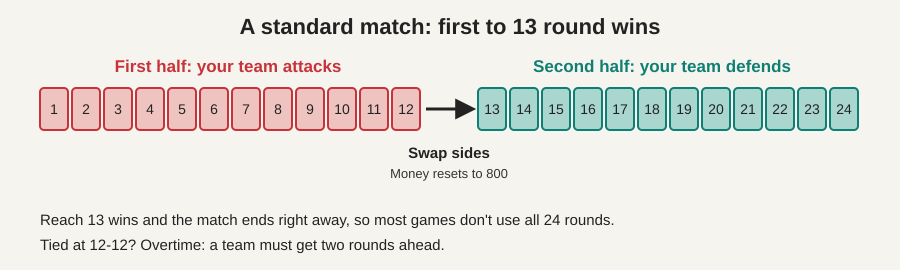
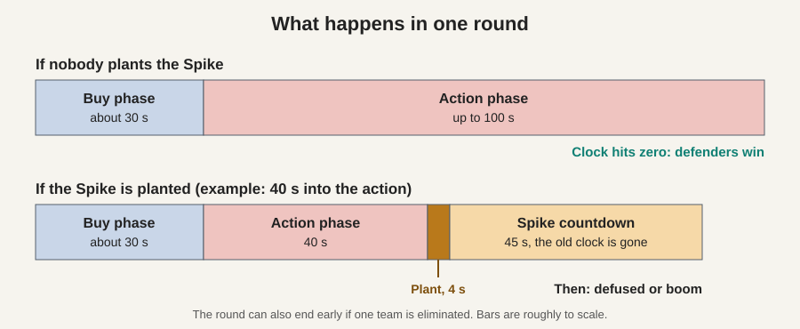
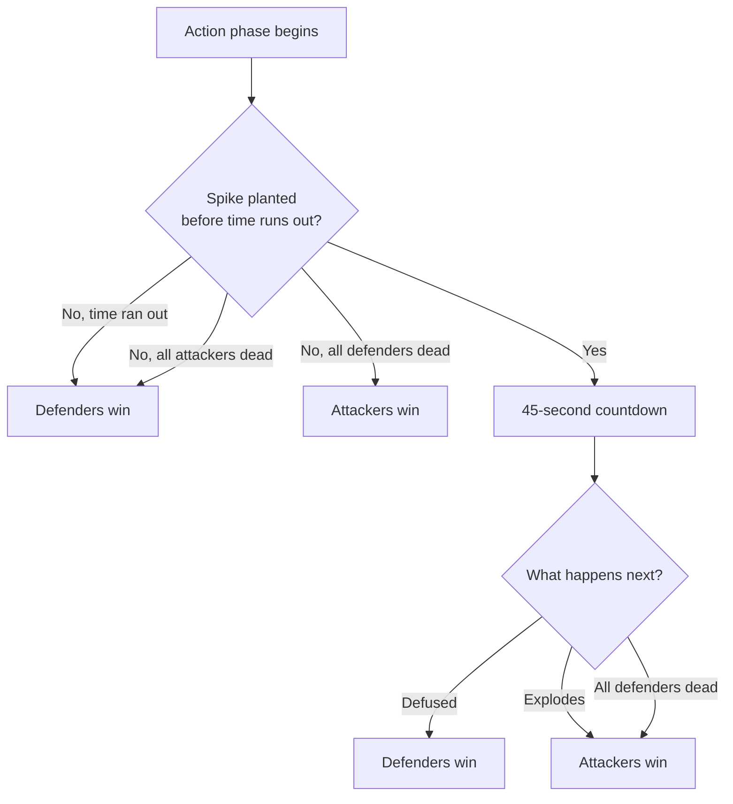

# 1. The Basics

[Back to index](README.md) | [Next: Planting and defusing](02_planting_and_defusing.md)

## What a match looks like

The standard game is 5 players against 5, and the first team to win **13 rounds** wins the match. It takes about 30 to 45 minutes.

Think of a tennis match: there are many short points, and players change ends partway through.

- **Rounds 1 to 12:** your team plays one side, for example attack.
- **Round 13 onward:** the teams swap sides.
- **At 12-12:** the match goes to **overtime**, where a team has to get two rounds ahead. In Competitive, teams can also vote to accept a draw.

**Example:** your team attacks first and leads 8-4 at the swap. You now defend, and need 5 more round wins to reach 13.

## What a round looks like

You get **one life per round**. If you die, you watch your teammates until the next round. This is the biggest difference from many shooters, and it is why players are so careful.

1. **Buy phase (about 30 seconds).** Everyone is held behind a barrier and spends money on guns, armor and abilities.
2. **Action phase (up to 100 seconds).** The barriers drop and the fight begins.
3. **Spike phase (45 seconds, only if planted).** Once the Spike is down, the normal clock is replaced by the bomb's countdown.

## How a round is won

| Attackers win if... | Defenders win if... |
|---|---|
| They eliminate all defenders | They eliminate all attackers **before** the Spike is planted |
| The planted Spike explodes | They defuse the planted Spike |
| | The clock runs out with no Spike planted |

**The rule that surprises beginners:** once the Spike is planted, killing every attacker does *not* win the round. The defenders still have to defuse it, or it explodes and the attackers win.

## Three things that make Valorant feel different

| Feature | In plain English | Example |
|---|---|---|
| **Aim matters a lot** | Headshots do far more damage, and guns are least accurate while you run | Stop moving for a moment before you fire |
| **Sound gives you away** | Running footsteps can be heard by enemies, while walking is silent | A slow walk lets you sneak up on a guard |
| **Powers set up the fight** | Abilities block vision, reveal enemies or blind them | Throw a smoke to cross a dangerous gap |

## Key takeaway

A match is a series of short, one-life rounds. Attackers try to plant the Spike and protect it, while defenders try to stop the plant or defuse it. First to 13 wins.
