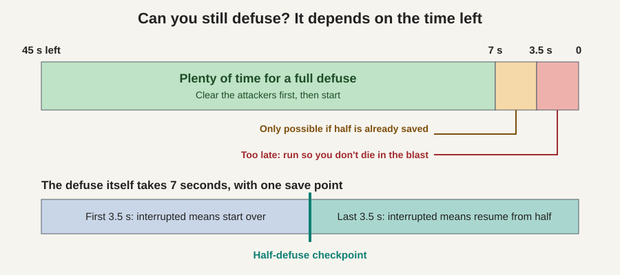
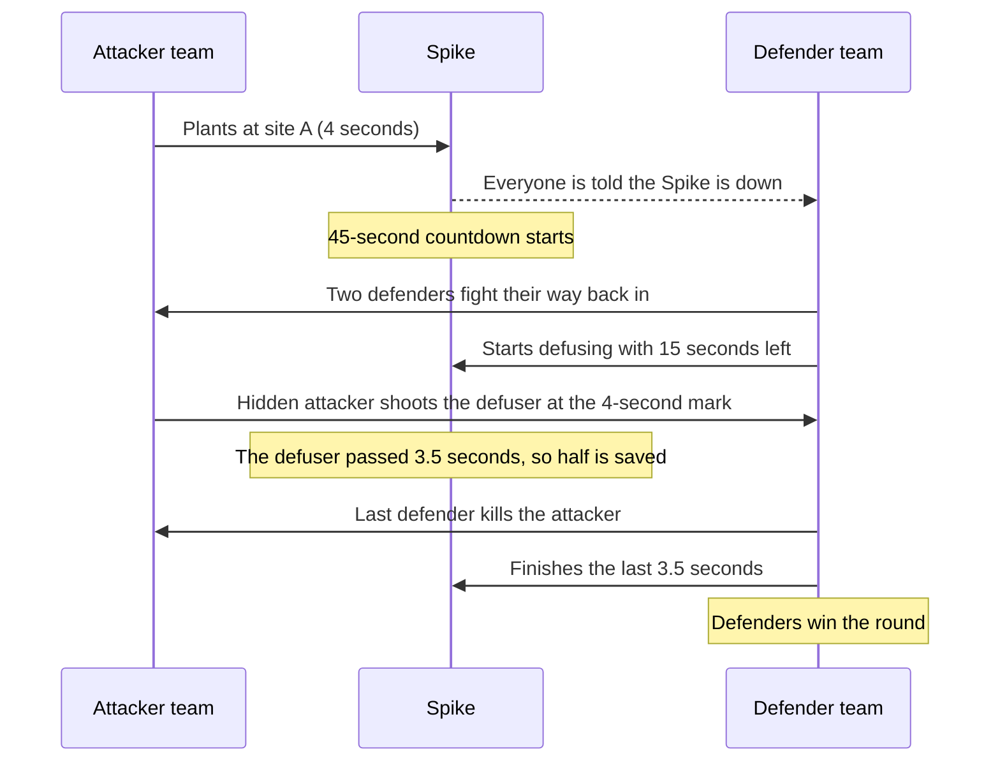

# 2. Planting and Defusing the Spike

[Previous: The basics](01_the_basics.md) | [Back to index](README.md) | [Next: Attacking and defending](03_attacking_and_defending.md)

## The Spike in one minute

The **Spike** is Valorant's bomb. Only one exists per round in the standard modes, and an attacker starts with it.

| Action | Who can do it | Time | Numbers to remember |
|---|---|---|---|
| Plant | Attackers, inside a site's marked plant zone | 4 seconds | Hold the plant key and stay still |
| Countdown | Happens automatically | 45 seconds | The beeping speeds up near the end |
| Defuse | Defenders | 7 seconds | Saved at the halfway point, 3.5 seconds |

## Carrying and dropping it

The carrier is like a relay runner holding the baton.

- If the carrier dies, the Spike **drops on the ground**, and any attacker can pick it up.
- Defenders can't pick it up, but they can stand guard over it. Any attacker who comes to collect it walks into their aim.
- If nobody plants before the timer ends, the defenders win.

**Example:** your Spike carrier dies in the open, in the middle of the map. Your team now has to win that fight, or the round is close to lost, even with everyone else alive.

## Planting

While planting, you can't shoot and you can't move. If you stop or get killed before the 4 seconds finish, the plant is cancelled.

**Example:** you've cleared site B. A teammate watches the door while you plant. A lone planter is an easy target, so this teamwork matters.

Every attacker also gets **300 bonus credits** when the Spike is planted, even if the team loses the round. [Part 5](05_money_and_guns.md) explains why this matters.

## Defusing, and the half-defuse trick

Defusing takes 7 seconds, and you can't shoot while doing it. There is one important checkpoint: **once you reach 3.5 seconds, that progress is saved**.

It's like a video game save point. If you're interrupted before the checkpoint, you restart from zero. If you're interrupted after it, you only need the last 3.5 seconds.

## The only math you need

To defuse in time, the time left has to be at least the time you still need.

| Time left on Spike | Defuse progress saved | Can you still make it? |
|---|---|---|
| 12 seconds | None | **Yes**, you need 7 |
| 7 seconds | None | **Only just**, so start immediately |
| 5 seconds | None | **No**, you need 7, so run away |
| 5 seconds | Half done | **Yes**, you need 3.5 |
| 3 seconds | Half done | **No**, you need 3.5 |

Run from the Spike when you can't make it. The explosion kills anyone caught nearby, and surviving means keeping your gun for the next round.

## The fake defuse

The sound of a defuse starting can be heard by the attackers. A defender can start defusing for a moment, then stop and aim, hoping a hiding attacker jumps out to stop it. It's like rattling a door handle to see who comes running.

## A short story

## Key takeaway

Remember **4, 45, 7**: 4 seconds to plant, 45 seconds until it explodes, and 7 seconds to defuse, with progress saved at the halfway point.
