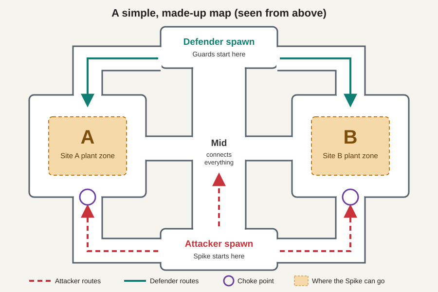
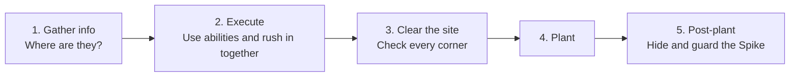
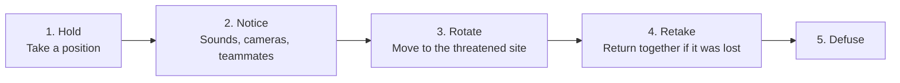

# 3. Attacking and Defending

[Previous: Planting and defusing](02_planting_and_defusing.md) | [Back to index](README.md) | [Next: Agents and abilities](04_agents_and_abilities.md)

## How a map is laid out

Most maps follow the same pattern. This is a made-up example, not a real map:

- **Spawn:** where your team starts each round.
- **Sites:** the marked zones where the Spike can be planted. Most maps have two, A and B, and a few, such as Haven and Lotus, have three.
- **Mid:** the middle area that connects everything. Controlling it lets you reach either site quickly.
- **Choke:** a narrow doorway or corridor that everyone has to pass through. These are the most dangerous places on the map.

## The core idea: attackers choose, defenders react

Attackers pick where to strike. Defenders have to cover everything, so they are spread thin.

**Example:** on a two-site map, defenders might put 2 players at A, 2 at B and 1 in mid. If all 5 attackers rush B, it's 5 against 2 until help arrives. That's the attackers' main advantage.

Defenders have their own advantage: they get to their positions first and can wait with their aim ready. Whoever walks around the corner is at a disadvantage.

## Playing attack

Attacking usually goes through these steps:

| Step | What you do | Burglar version |
|---|---|---|
| Gather info | Scout with abilities and quiet movement | Check which vault has fewer guards |
| Execute | Smoke off long sightlines, flash, then enter together | Cut the lights and all go in at once |
| Clear the site | Check corners and common hiding spots | Make sure nobody is behind the door |
| Plant | One player plants while others cover | One sets the bomb while others keep watch |
| Post-plant | Spread out and aim at the Spike | Hide and catch anyone who tries to disarm it |

**Good habit:** after planting, don't stand right beside the Spike. Pick a spot from which you can see it from a distance. Defenders must come to you, and they can't shoot while defusing.

## Playing defense

Defending usually goes through these steps:

| Term | What it means | Example |
|---|---|---|
| **Hold** | Wait in a spot and watch an entrance | Aim at the B doorway from behind a box |
| **Rotate** | Move from one site to help the other | A teammate calls "all B", so you run over from A |
| **Retake** | Win back a site after the Spike is planted | Three of you wait for each other, then enter together |
| **Stack** | Put extra players on one site as a gamble | Four players sit on B, leaving A nearly empty |

**Common beginner mistake:** rotating at the first sound. Attackers often **fake** a site by making noise and using abilities there, then hit the other one once the defenders have moved.

## One full round, as a story

You're an attacker on the made-up map above.

1. **Buy phase:** your team buys rifles and armor. Your teammate has the Spike.
2. **0:20 into the action:** a scout's ability shows two defenders near A, so your team decides to go B.
3. **0:45:** one player makes noise at A as a fake, while the other four gather near B.
4. **1:00:** smoke blocks the guard's view, a flash goes in, and you rush the site. You win the fight 2 for 1.
5. **1:10:** your teammate plants. Your team earns its plant bonus, and the 45-second countdown starts.
6. **1:30:** the defenders return. Your team hides around the site and kills the first player who tries to defuse.
7. **1:55:** the Spike explodes. **Attackers win the round**, and everyone gets the win bonus.

## Key takeaway

Attackers have the choice of where to fight. Defenders have the head start and better positions. Most of the strategy is about using information to get more of your team to a fight than the other side has.
