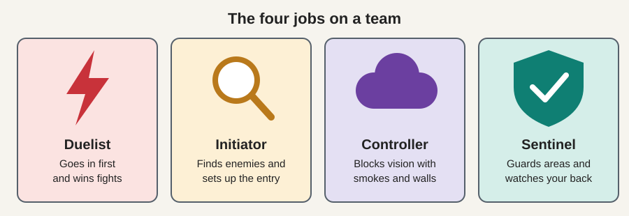
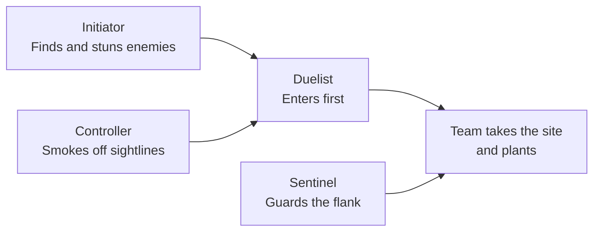

# 4. Agents and Abilities

[Previous: Attacking and defending](03_attacking_and_defending.md) | [Back to index](README.md) | [Next: Money and guns](05_money_and_guns.md)

## What's an agent?

An **agent** is the character you play. All agents have the same health and can use the same guns, so the powers are what set them apart. Picture a heist crew where everyone can carry a gun, but one is the lookout and another handles the explosives.

Each player on a team must pick a different agent, and there are 30 to choose from on Riot's agent page. New ones are added over time.

## The four roles

| Role | Job | Football comparison | Heist comparison | Agents |
|---|---|---|---|---|
| **Duelist** | Go in first and win fights | Striker | The one who kicks the door in | Hush, Iso, Jett, Neon, Phoenix, Raze, Reyna, Waylay, Yoru |
| **Initiator** | Find enemies and set up the entry | Playmaker | The scout with the drone | Breach, Fade, Gekko, KAY/O, Skye, Sova, Tejo |
| **Controller** | Block vision with smokes and walls | Midfielder who controls the space | The one who cuts the lights | Astra, Brimstone, Clove, Harbor, Miks, Omen, Viper |
| **Sentinel** | Protect areas and watch your back | Goalkeeper | The one who sets the alarms | Chamber, Cypher, Deadlock, Killjoy, Sage, Veto, Vyse |

A balanced team usually has at least one Controller and one Initiator. Smokes and information are hard to replace, even with excellent aim.

## The four ability slots

Every agent has four abilities, each on its own key.

| Slot | How you get it | Think of it as... |
|---|---|---|
| **Basic abilities (2)** | Buy with credits each round | Gadgets you pay for |
| **Signature ability** | Free each round, and some recharge | The gadget that comes with the job |
| **Ultimate** | Earned by collecting points during the match | Your big, game-changing move |

Ultimate points come from getting kills, dying, planting or defusing, and collecting orbs on the map. It's a charge meter that fills up over several rounds.

## What abilities actually do

| Type | What it does | Example |
|---|---|---|
| **Smoke** | Blocks vision in an area | Omen smokes a doorway so the guard can't see you cross |
| **Flash** | Briefly blinds anyone looking at it | Breach flashes through a wall right before your team enters |
| **Reveal** | Shows where enemies are | Sova fires an arrow that scans nearby enemies |
| **Trap** | Warns of or slows intruders | Cypher's tripwire catches a sneaky attacker |
| **Damage** | Hurts or pushes enemies out of a spot | Raze throws a grenade at a corner where someone is hiding |
| **Movement** | Quick reposition | Jett dashes across a gap in an instant |
| **Healing** | Restores health | Sage heals a teammate, and her ultimate brings one back to life |

## Which agent should a beginner pick?

| If you like... | Try | Why |
|---|---|---|
| Helping the team | **Sage** | Healing and walls are straightforward and always useful |
| Simple, strong smokes | **Brimstone** | You place smokes from a map, with little technique needed |
| Fighting first | **Phoenix** | Can heal himself and has an easy-to-use flash |
| Guarding an area | **Killjoy** | Gadgets do a lot of the work for you |
| Scouting | **Sova** | Clear job, though the arrows take practice to aim well |

These are common starting suggestions, not the "best" agents. New accounts begin with only some agents unlocked, so check which ones you have.

## Key takeaway

Agents differ only by their powers, and each role has a clear job: Duelists fight, Initiators scout, Controllers block vision and Sentinels guard.
