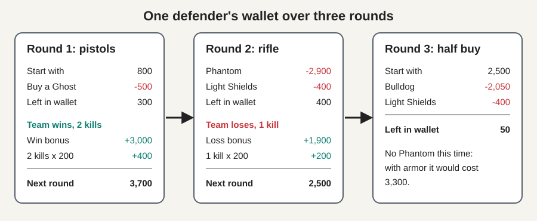
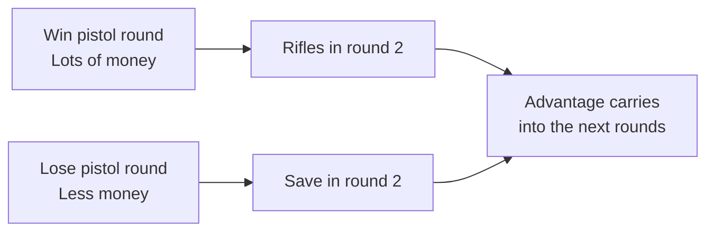

# 5. Money and Guns

[Previous: Agents and abilities](04_agents_and_abilities.md) | [Back to index](README.md) | [Next: All the game modes](06_game_modes.md)

## The money game

Before each round you spend **credits** on your gear. Credits are like a monthly budget: spend everything on one big purchase, and you might not be able to afford the next one.

Your money carries over between rounds, up to a limit of 9,000. It resets at the side swap, when everyone starts over with 800.

## How you earn

| Event | Credits |
|---|---|
| Each kill | +200 |
| Your team wins the round | +3,000 |
| Your team loses the round | +1,900 |
| Two losses in a row | +2,400 |
| Three or more losses in a row | +2,900 |
| Your team plants the Spike | +300 each |
| Overtime rounds | Everyone gets a fixed 5,000 |

The growing loss bonus keeps the losing team in the game. Think of it as a catch-up payment.

**The exceptions:** an attacker who survives a lost round where the Spike was never planted gets only **1,000** instead of the normal loss money. A defender who survives after the Spike explodes gets the same. This discourages hiding to save your gun instead of playing the objective.

## What's in the shop

Prices are in credits. Riot adjusts them from time to time, so the buy menu in the game always has the final word.

| Type | Gun | Price | Plain-English use |
|---|---|---|---|
| Sidearm | Classic | Free | The free pistol everyone starts with |
| Sidearm | Shorty | 300 | Tiny shotgun, close range only |
| Sidearm | Frenzy | 450 | Fast-firing pistol |
| Sidearm | Ghost | 500 | Quiet, accurate pistol |
| Sidearm | Sheriff | 800 | Revolver with big damage per shot |
| SMG | Stinger | 1,100 | Cheap and fast, close range |
| SMG | Spectre | 1,600 | Quiet all-rounder for close to medium range |
| Shotgun | Bucky | 850 | Cheap, powerful up close |
| Shotgun | Judge | 1,850 | Automatic shotgun for tight spaces |
| Rifle | Bulldog | 2,050 | Budget rifle |
| Rifle | Guardian | 2,250 | Slow but hard-hitting long-range rifle |
| Rifle | **Phantom** | 2,900 | Quiet, easy-to-control main rifle |
| Rifle | **Vandal** | 2,900 | Main rifle that kills with one headshot at any range |
| Sniper | Marshal | 950 | Cheap, light sniper |
| Sniper | Outlaw | 2,400 | Two-shot sniper |
| Sniper | Operator | 4,700 | Very expensive and usually kills in one body shot |
| Heavy | Ares | 1,600 | Machine gun |
| Heavy | Odin | 3,200 | Bigger machine gun that sprays through walls |

Patch 13.09 also lists a gun called the **Warden** at 2,900.

| Armor | Price | Adds |
|---|---|---|
| Light Shields | 400 | 25 protection on top of 100 health |
| Heavy Shields | 1,000 | 50 protection on top of 100 health |

## Three ways to spend

| Type of round | What you buy | Budget | Shopping comparison |
|---|---|---|---|
| **Full buy** | Rifle, heavy shields and abilities | About 4,000 or more | The full weekly shop |
| **Half buy** | SMG or budget rifle, light shields | About 2,000 to 3,000 | Only the essentials |
| **Save, or "eco"** | Little or nothing | Under about 1,000 | Skip the shop to afford a full one next time |

**The golden rule:** buy *together*. One player with a rifle and four with pistols usually loses to a team that's all fully bought. Teams therefore usually save or buy as a group.

**Keep what you survive with.** If you are alive at the end of a round, you keep your gun and any remaining shields. If you die, an enemy can pick your gun up.

## A worked example

Here's one defender's wallet across three rounds:

Notice round 3: losing round 2 means a smaller budget. If the bonus had been larger or the player had got more kills, they might have afforded a Phantom again.

## Pistol rounds

Rounds 1 and 13 are special, because everyone has only 800 credits, so nobody can afford a rifle. Winning one matters a lot: the winners can afford better gear in the next round, while the losers often have to save.

## Key takeaway

Money decides what you can bring to each fight. Spend with your team, save together when you can't afford a full buy, and remember that the plant bonus pays even when you lose.
