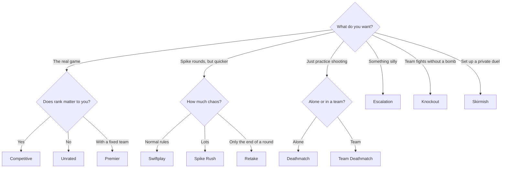

# 6. All the Game Modes

[Previous: Money and guns](05_money_and_guns.md) | [Back to index](README.md) | [Next: Cheat sheet](07_cheat_sheet.md)

Riot adds, changes and retires modes over time, so the queue list in your game is the final word. This page reflects what could be confirmed in November 2026.

## Which mode should I play?

## Quick comparison

| Mode | Teams | How you win | About how long | Spike? |
|---|---|---|---|---|
| **Competitive** | 5v5 | First to 13 rounds | 30 to 45+ min | Yes |
| **Unrated** | 5v5 | First to 13 rounds | 30 to 45 min | Yes |
| **Premier** | 5v5 fixed team | Competitive-style rules | 30 to 45+ min | Yes |
| **Swiftplay** | 5v5 | First to 5 rounds | 15 to 20 min | Yes |
| **Spike Rush** | 5v5 | First to 4 rounds | 10 to 15 min | Yes |
| **Retake** | 3v3 | First to 5 rounds | Short | Already planted |
| **Knockout** | Two teams | First to 4 rounds | 8 to 15 min | No |
| **Skirmish** | 1v1 up to 5v5 | First to 10 rounds | 7 to 9 min | No |
| **Team Deathmatch** | 5v5 | Reach the target kill count | About 10 min | No |
| **Deathmatch** | Free-for-all | First to 40 kills, or most kills in 9 min | Up to 9 min | No |
| **Escalation** | 5v5 | First through all 12 weapon levels | 7 to 9 min | No |

## The full game

### Competitive
This is the ranked version, with the rules explained in [part 1](01_the_basics.md). You earn or lose rank depending on results. It unlocks after you reach a required account level, which guides list as 20.

*Think of it as playing in a league where the table counts.*

### Unrated
These are the same rules with no rank at stake, making it the best place to learn the full game.

*Think of it as a friendly match on a full-sized pitch.*

### Premier
Pre-made teams of five play scheduled matches in a seasonal league.

*Think of it as joining a local club and playing on match days.*

## Shorter Spike modes

### Swiftplay
This is the normal game shrunk down, with sides swapping after 4 rounds and the first team to 5 winning. You still buy gear and use the economy.

*Think of it as T20 cricket next to a full test match, or a short set of tennis.*

### Spike Rush
This one is a fast party version with no shopping:

- **Every attacker** carries a Spike, so defenders must watch everything.
- Everyone gets the **same random gun** each round.
- Abilities start charged, and power-up **orbs** appear around the map.
- First to 4 rounds wins.

**Example:** one round everyone has shotguns, and the next it's sniper rifles. You can't plan, so you just adapt.

### Retake
This one drops you straight into the end of a round: 3 against 3, with the **Spike already planted**. Attackers guard it and defenders must retake and defuse it, and there's no economy. First to 5 wins.

*Think of it as practicing only penalty kicks instead of playing a whole match.* It's a great way to practice the [post-plant](03_attacking_and_defending.md#playing-attack) you learned about.

## Fights with no bomb

### Knockout
Added in March 2026. Two teams fight round by round until one side is wiped out, and **killing an enemy revives a fallen teammate**. First to 4 rounds wins. A comeback is always possible, since one good kill brings someone back.

### Skirmish
Short, round-based fights from 1v1 up to 5v5, on three small dedicated maps (Skirmish A, B and C), with no Spike. First to 10 rounds wins, and the settings can be customized, for example to turn on abilities. It's the one to use to settle a duel with a friend.

### Team Deathmatch
Two teams of five fight with instant respawns until a team reaches the target number of kills. It's excellent for trying out guns and abilities with little pressure.

### Deathmatch
Every player is on their own, with instant respawns and no abilities. First to 40 kills wins, or the highest score when the 9-minute timer ends. Many players use it as a warm-up.

*Think of it as hitting balls at a driving range before a round of golf.*

### Escalation
Teams of five work through a fixed list of **12 weapons and abilities** by getting kills, and the first team to finish wins. You don't get to choose your weapon, which makes it a funny mode.

**Example:** your team might go from a machine gun to a shotgun, then to much weaker or stranger items as you near the end of the list.

## Limited-time and retired modes

| Mode | Status |
|---|---|
| **Replication** | Reported as retired. Both teams played five copies of one voted-for agent. |
| **Gauntlet: Glitched** | Riot news item from September 2026 describing 16 players in 8 teams. Check the game to see if it's running. |

## Key takeaway

Start with **Swiftplay** to learn Spike rules quickly, warm up in **Deathmatch**, and move to **Unrated** once you're comfortable. Play **Competitive** once you want your results to count.
