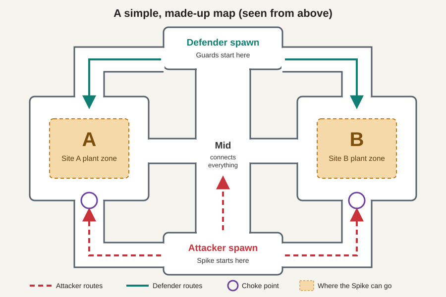
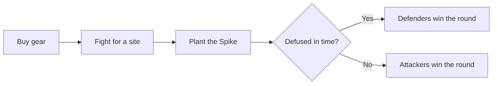

# Valorant, in Plain English

**Valorant** is a free online shooting game for PC and consoles where two teams of 5 fight in short rounds. One team tries to plant a bomb, called the **Spike**, and the other team tries to stop them. Every player also has a few special powers.

*Facts checked against Riot's site and recent guides in November 2026 (patch 13.09). See [Sources](07_cheat_sheet.md#sources).*

## The one analogy to remember

Imagine a game of **burglars and guards** in a building with two vaults:

- The **burglars** sneak in and try to leave a time bomb in *either* vault.
- The **guards** don't know which vault will be hit, so they have to split up.
- If the bomb goes off, the burglars win. If the guards disarm it, the guards win.
- If either team is wiped out first, the round usually ends right there.
- After 12 rounds, the teams **swap jobs**.

| Burglars and guards | Valorant term |
|---|---|
| Burglars | Attackers |
| Guards | Defenders |
| Time bomb | Spike |
| Vault | Site (usually A or B) |
| Leaving the bomb | Planting |
| Disarming the bomb | Defusing |
| Each person's special gadget | Abilities |
| Cash for gear before each round | Credits |

## Reading order

| # | Page | Question it answers |
|---|---|---|
| 1 | [The basics](01_the_basics.md) | What happens in a match and in a round? |
| 2 | [Planting and defusing](02_planting_and_defusing.md) | How does the bomb actually work? |
| 3 | [Attacking and defending](03_attacking_and_defending.md) | What is each team supposed to do? |
| 4 | [Agents and abilities](04_agents_and_abilities.md) | Who are the characters and what are the powers? |
| 5 | [Money and guns](05_money_and_guns.md) | What should I buy, and when should I save? |
| 6 | [All the game modes](06_game_modes.md) | What else can I play, and which mode suits me? |
| 7 | [Cheat sheet](07_cheat_sheet.md) | What does that jargon mean? |

**Prefer to click around?** Download this folder and open [visual_guide.html](visual_guide.html) in a browser. It has a step-by-step round walkthrough, a "can I still defuse?" timer and a mode picker.
